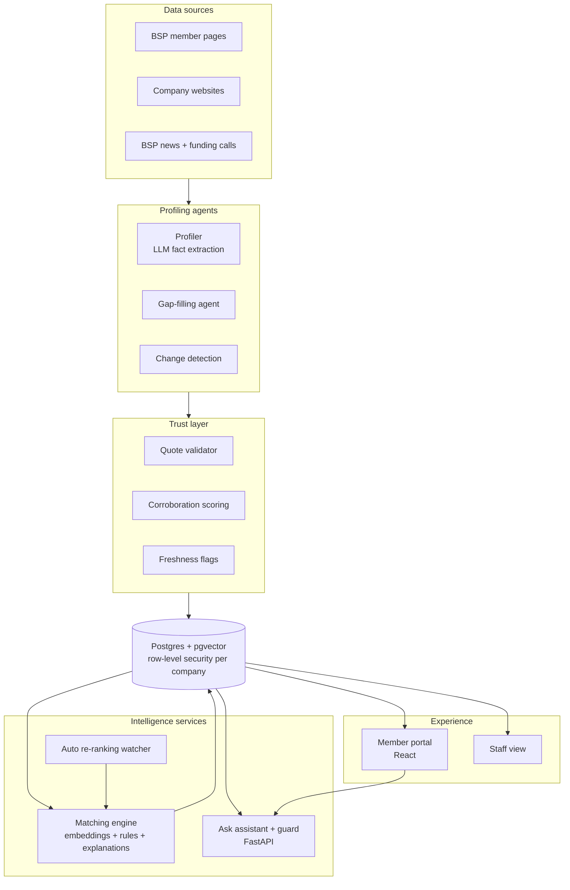

# Virtual Science Park

**AI agents that build verified profiles of Blue Science Park's member companies from public data, and match each company to the right funding, events, testbeds and support, with a reason for every recommendation.**

Built in 24 hours at **BUILD Hackathon 2026** (Karlskrona) for the Blue Science Park challenge.

**Live demo:** https://virtual-science-park.vercel.app · demo logins on request

> Every fact has a source. Every recommendation has a reason. Every company sees only its own data.
> When a member changes their priorities, the recommendations follow.

---

## What it does

| | |
|---|---|
| **Profiles from public data** | Agents read BSP member pages, company websites and BSP news, and extract facts (offering, technology, market, priorities…). Each fact keeps the **exact quote, source URL and date**, labelled *stated*, *inferred* or *missing*. |
| **Trust layer** | Quotes are checked against the source page; facts are cross-checked across sources and scored **confirmed / plausible / stale**. Old sources are flagged, not trusted. |
| **Gap-filling agent** | Finds empty profile fields, searches BSP news for the company, decides which articles are relevant, and adds the facts with proof. |
| **Matching with reasons** | Ranks real opportunities (Energimyndigheten calls, BSP events, testbeds, support) per company and explains each match using the company's own facts. Funding is always a *potential* match; eligibility is never promised. |
| **Live re-ranking** | A member adds a priority or rejects a fact → the ranking updates automatically (~15–20 s), even if the LLM is down (template fallback). |
| **Guarded assistant** | Members ask questions in plain language. Prompt injection, cross-company requests and eligibility guarantees are refused. |
| **Staff view** | Compare two companies' recommendations side by side, plus member-to-member connection suggestions from the Connector agent. |

## Architecture



**Stack:** Python · Gemini (OpenAI-compatible API) · multilingual sentence embeddings (Swedish + English) · Supabase (Postgres, Auth, RLS, pgvector) · FastAPI · React + Vite + Tailwind · Vercel + Render

**Two real agents** (they observe, decide and act): the **gap-filling agent** and the **Ask assistant**. The profiler, corroboration and matching are deliberately fixed pipelines, which makes them easy to test and audit.

## Results

| Check | Result | Evidence |
|---|---|---|
| Profile accuracy (hand-checked facts) | **91%** (31/34) | `eval/results/QUALITY.md` |
| Matching precision@5 (3 companies) | **66.7%** | `eval/results/precision.md` |
| Data isolation, tested as a real member | **5/5** | `eval/check_db.py` |
| Prompt-injection test (simulated hostile page) | **PASS** | `eval/injection_test.py` |
| Match reasons cite only the same company's real facts | **30/30** (49/49 references) | `eval/check_reasons.py` |
| Live re-rank publication, sampled reads | **0 empty reads** in 265 | `eval/results/atomic_publication.md` |
| Automated tests | **50** (profiling 22 · guard 24 · publishing 4) | `tests/`, `api/`, `eval/` |
| Scale | all **56** BSP members profiled (baseline) | `pipeline/profiler/out/baseline/` |

## Run it locally

```bash
# Python (pipelines + API)
python -m venv .venv && source .venv/bin/activate
pip install -r requirements.txt -r api/requirements.txt
cp .env.example .env            # fill in: never commit .env

uvicorn api.main:app --port 8000          # Ask API
python -m pipeline.monitor.watch          # auto re-ranking watcher

# Web app
cd web && npm install
cp .env.example .env.local      # VITE_SUPABASE_URL, VITE_SUPABASE_ANON_KEY, VITE_ASK_URL
npm run dev -- --port 5180
```

```bash
# Tests (no keys or network needed)
pytest tests api/test_guard.py eval/test_match_publication.py -q
```

## Security

- Pipelines use the service-role key; the web app and the Ask API only ever use the **member's own login** (row-level security enforced in the database).
- No LLM key in the browser. Funding is never presented as guaranteed.
- Data marked **SIMULATED** is used only for demo scenarios.

## Honest limits and next steps

| Today | Next step |
|---|---|
| 3 companies live in the app; 56 profiled as a baseline | load all members, with staff review |
| Curated set of real opportunities | live crawlers for Vinnova and EU calls |
| Watcher polls for changes | event-driven re-ranking (database triggers → queue) |
| Precision@5 from a small labelled sample | larger labelled set, tracked over time |
| Some events lack confirmed upcoming dates | date extraction + "no upcoming date" label |

## Team

Built by a team of four: profiling and quality agents, matching and re-ranking, data platform and assistant, and web app. AI coding assistants (Claude, Gemini) were used as tools; architecture, data decisions and all verification were done by the team.
